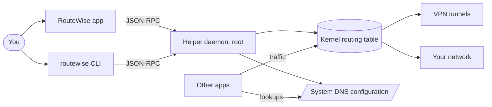
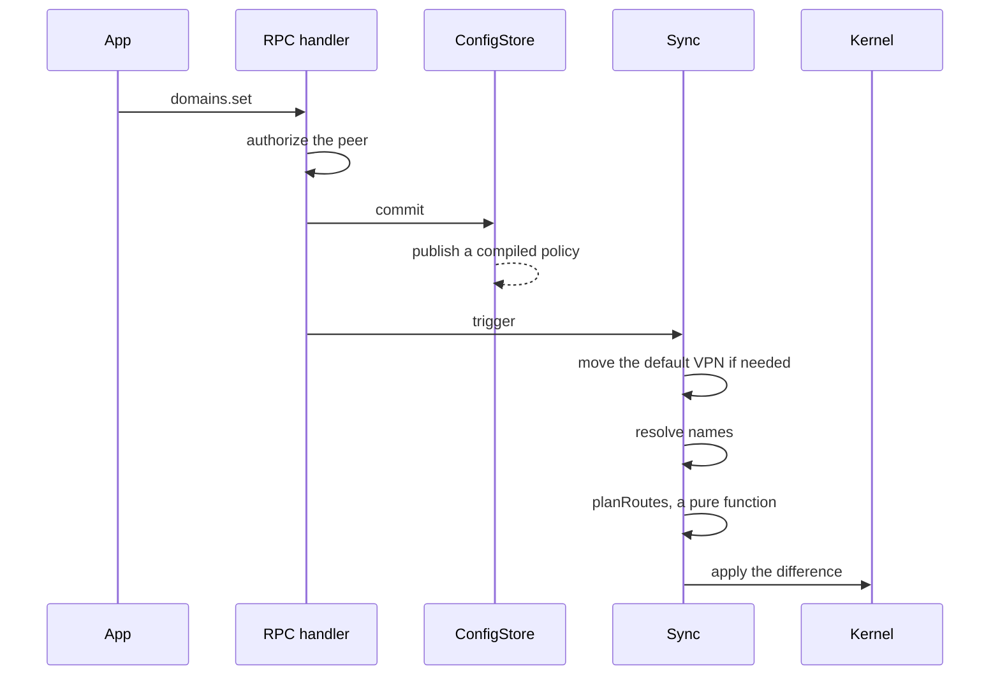

# Architecture

## Context

RouteWise changes where packets go by editing the routing table. It does not proxy traffic, except that a built-in VPN's tunnel runs inside the
helper.

## Containers

| Part | Language | Runs as | Does |
|---|---|---|---|
| Helper (`cmd/routewise`, `internal/`) | Go | Root, as a system service | Everything privileged: routes, DNS, built-in tunnels, the database |
| CLI (`cmd/routewise`) | Go | You | The same binary, talking to the helper over RPC |
| App shell (`desktop/src-tauri`) | Rust | You | Window, tray, notifications, one status poller, system figures |
| App UI (`desktop/src`) | TypeScript, Next.js | Webview | Screens. Reaches the helper only through the shell |

The privileged part is small in reach: the only way in is the [socket](security.md), and the app holds no privileges.

## Inside the helper

| Package | Responsibility |
|---|---|
| `internal/daemon` | Orchestration: sessions, syncs, the control loop, health |
| `internal/route` | One route manager per tunnel, kernel tables per platform, transition journals |
| `internal/monitor` | Detecting full-tunnel VPNs |
| `internal/vpnclient` | Which program owns a tunnel |
| `internal/dns`, `dnsproxy`, `resolverfiles` | Resolving, the wildcard forwarder, split DNS configuration |
| `internal/dnswatch` | Passive capture of DNS answers and connection starts |
| `internal/activity`, `history`, `batchwriter` | The activity log and access history |
| `internal/config`, `configdb` | The configuration and its SQLite storage |
| `internal/ledger` | Crash journals |
| `internal/wgtunnel`, `outlinetunnel`, `tunnelnet` | Built-in tunnels |
| `internal/api`, `ipc` | RPC types, the handler, the transport |

## How a change reaches the table

## Design patterns in use

| Pattern | Where | Why |
|---|---|---|
| Immutable snapshot | `routingPolicy` | DNS and packet paths read it with no lock or copy |
| Pure core, imperative shell | `planRoutes`, `defaultVPNTarget` | Who gets a route can be tested without a kernel |
| Control loop | `controlLoop` | One goroutine keeps decisions in place against the outside world |
| Strategy | `route.Table`, one per platform | Routing logic does not know the operating system |
| Decorator | `routeSocketRunner` | Route changes skip a process start, with `route(8)` behind it |
| Registry, table-driven | `tunnelKinds`, `rpcMethods`, `config.Settings`, `settingRules` | Adding one is one row |
| Journal | `transaction`, `ledger.Ledger[T]` | What was changed survives a crash, so it can be undone |
| Ports and adapters | `daemonHooks`, `defaultVPNHost` | Reaching outside goes through a seam tests can replace |
| Observer | The shell's `helper://status` and `system://stats` | One poller, and the window hears about changes |

## Concurrency

`mutationMu` makes "this generation still owns the routes" and the change itself one critical section. The lock order is written at its
declaration in `internal/daemon/daemon.go`. Reads on hot paths take no lock, and syncs run apart from the control loop because a sync can wait
seconds on a DNS server.

A *generation* is the runtime that may change routes. An event buffered before shutdown belongs to an old generation and does nothing.
